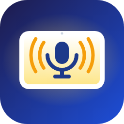

# Noise Wake



A [Kiosk Satellite](https://github.com/jxlarrea/kiosk-satellite) plugin that closes the screensaver as soon as the microphone hears sound above a threshold you set. Talk, walk in or put something down near the kiosk and the dashboard comes back right away, without touching the screen.

The plugin measures how loud each 50 ms of audio is and reacts within a fraction of a second. When sound stays at or above your threshold for the minimum duration, it dismisses the screensaver, which also wakes the display and resets the idle timer.

Turn on **Stay awake while there is sound** to also keep the screensaver from starting while the room is loud. Once it gets quiet, the normal screensaver countdown starts again. It is off by default, so the microphone is only open while the screensaver shows.

## Home Assistant

Noise Wake publishes an **Enabled** switch. With ESPHome and native entities turned on in Kiosk Satellite, it shows up in Home Assistant, so an automation can turn Noise Wake off at night or while nobody is home. It does the same as the **Enabled** setting: while it is off, the microphone stays closed. Unlike disabling the plugin in Plugin Manager, the switch stays available so Home Assistant can turn it back on.

## Settings

All settings are in **Settings > Plugin Manager > Noise Wake** on the kiosk and in Remote Admin. Changes apply right away.

| Setting | Default | What it does |
| --- | --- | --- |
| **Enabled** | On | Turn Noise Wake off without disabling the plugin. While it is off, the microphone stays closed. Also available as a switch in Home Assistant |
| **Loudness threshold** | -35 dBFS | Sound at or above this level closes the screensaver. 0 dBFS is the loudest the microphone records, so a number closer to 0 needs louder sound. -60 is very sensitive, -20 needs loud sound |
| **Minimum duration** | 100 ms | How long the sound has to stay above the threshold. 0 reacts to any spike. Raise it if single clicks or bumps wake the screen |
| **Cooldown** | 10 s | After waking the screen, ignore sound for this long |
| **Also wake a display that is off** | Off | Also listen while the display is off and turn it on when sound crosses the threshold |
| **Stay awake while there is sound** | Off | While sound stays above the threshold, keep the screensaver from starting. Short pauses, such as between words, count as sound. Half a second after it gets quiet, the normal screensaver countdown starts again from the beginning |
| **Audio source** | Microphone | The Android audio source to record from: Microphone, Voice recognition, Camcorder or Unprocessed. Try another one if the level stays at silence or if the wake word stops working while the screensaver shows |
| **Measure the room** | Off | Keep the microphone open and show the live level in the plugin's status, so you can pick a threshold |

### Find the right threshold

1. Turn on **Measure the room**.
2. Watch the status at the top of the plugin page. It shows the level now and the loudest level in the last 10 seconds.
3. Note the level of the quiet room, then the level of the sound that should wake the screen, such as talking at normal volume.
4. Set **Loudness threshold** between the two, a little closer to the quiet level for a more sensitive kiosk.
5. Turn **Measure the room** off again.

The level is relative to this device's microphone and its gain, so every kiosk needs its own threshold.

## Privacy

Noise Wake sends no data anywhere. Audio is read from the microphone into memory, turned into a single loudness number per 50 ms and discarded. Nothing is recorded, stored or sent over the network. The plugin uses Kiosk Satellite's own microphone permission and its code makes no network requests.

With the default settings, the microphone is open only while the screensaver shows. With **Enabled** on, the microphone is open only while:

- the screensaver shows,
- the display is on and **Stay awake while there is sound** is on,
- the display is off and **Also wake a display that is off** is on, or
- **Measure the room** is on.

With **Enabled** off, the microphone is never open.

## Requirements and limitations

- Kiosk Satellite 2026.10.36 or newer, with the microphone permission granted. The status says so if the microphone cannot be opened.
- The Kiosk Satellite plugin SDK has no microphone API of its own, so Noise Wake records with Android's `AudioRecord` inside Kiosk Satellite. Android lets one app record more than once at the same time, so it normally runs alongside the wake word. If the wake word stops responding while the screensaver shows on your device, try another **Audio source**.
- If the status says the microphone only returns silence, another app is holding the microphone. Try another **Audio source**.

## Installation

### One click

Use the button below to open Noise Wake in your Kiosk Satellite and install it.

[](https://kiosksatellite.com/redirect/plugin/?repository=DanieldJonge/ks-noise-wake)

### Manual

1. Open **Settings > Plugin Manager** in Kiosk Satellite and turn on **Enable Plugins**.
2. Choose **Add plugin**, paste `https://github.com/DanieldJonge/ks-noise-wake` and choose **Preview**.
3. Review the plugin and choose **Trust and install**.
4. Enable **Noise Wake** and set the threshold as described above.

## Build from source

Install Python 3, JDK 17 or newer and an Android SDK with a platform and build-tools. Set `JAVA_HOME` and `ANDROID_HOME`, then run:

```sh
python3 tools/test.py
python3 tools/build.py
```

The ZIP lands in `dist/`. For testing, install it with **Plugin Manager > Developer Tools > Install from ZIP**.

Releases are built by GitHub Actions. Publish a GitHub release tagged with the version, such as `v1.1.0`, and the Release workflow tests the source, builds it and attaches the manifest, ZIP and checksum.

## License

[Apache-2.0](LICENSE). The SDK interfaces in `sdk/` and the build tools in `tools/` come from the [Kiosk Satellite plugin template](https://github.com/jxlarrea/kiosk-satellite-plugins) under the same license.
